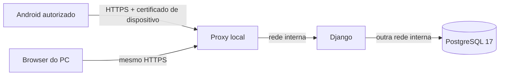

# Etapa 6 — Android no Wi-Fi autorizado

**Perfil sintético para instalação posterior**, dependente da informática. Não é
publicação de stocks nem instalação no PC real. A Etapa 5 continua independente.

## Solução

Reutiliza Django 5.2/Python 3.12, PostgreSQL 17, imagem Linux, PWA, páginas e serviços
transacionais. PC e Android usam o mesmo URL HTTPS e a única base dessa instalação.
Não há segunda base no Android, servidor externo, subscrição ou Stock Vendas offline.

O ensaio cria projeto `gg-wifi6-<id>`, volumes e segredos novos e três referências
fictícias. Não reutiliza volumes do piloto local nem liga à pré-visualização Excel.
O nome interno da base é o do bootstrap reutilizado, mas os clusters são separados.
PC/Android partilham apenas este ensaio. Não usar dois pilotos como fontes
operacionais. A transição para dados reais exige trabalho e autorização próprios;
este perfil recusa outros destinos.



Só o proxy publica `IP_LAN_APROVADO:8443`. Django/PostgreSQL não publicam portas,
nem em loopback. Proxy não pertence à rede da base. Não se monta o socket Docker.
A API Docker fica no named pipe local: não ativar TCP 2375/2376, dashboards ou
administração remota. Utilizadores da aplicação não recebem acesso ao Docker.

## Requisitos da informática

| Área | Ação autorizada necessária |
| --- | --- |
| Windows | Pré-requisitos da [Etapa 5](windows11.md): Docker Desktop/WSL2 e execução de scripts. Sem bypass/elevacão nos assistentes. |
| Endereço | Reserva DHCP/IP estável do adaptador LAN do PC, DNS interno único resolvido por PC/Android. Não usar IP temporário WSL nem depender de mDNS. |
| TLS servidor | Certificado com SAN do DNS e EKU serverAuth, chave privada e cadeia completa; CA empresarial confiada no Android/PC por MDM/processo autorizado, ou certificado de domínio próprio pelo processo da empresa. DNS público não precisa de apontar para o PC. |
| Dispositivos | Certificado clientAuth individual por dispositivo autorizado, chave protegida, instalação MDM/credenciais Android e no browser PC. CA emissora e CRL PEM válidas; revogação de aparelhos perdidos. Login individual continua obrigatório. |
| Rede | SSID/VLAN/ACL aprovados, firewall Windows limitada a IP local, porta TCP 8443, perfil e clientes aprovados. Reservar IPs de clientes quando usados na lista. Bloquear convidados/Internet, sem DMZ, UPnP ou port forwarding. |
| Docker | `/29` RFC1918 livre, sem sobreposição com LAN/VPN/WSL/outros projetos; segundo IP útil para proxy, terceiro para Django (`AppIP`), distintos. |
| Operação | Relógios certos, renovação/revogação de certificados e CRL, repouso/arranque do PC, backups/recuperação autorizados. |

Confiar no certificado **antes** de abrir/instalar a PWA. Nunca ignorar avisos,
desligar TLS ou instalar uma CA de fonte não verificada. Scripts não geram uma CA
empresarial nem instalam certificados/políticas. A PKI de testes é efémera, só no CI.

Exige-se TLS mútuo (mTLS) além da conta porque NAT do Docker Desktop pode ocultar
o IP Android. `AllowedClients` é uma segunda restrição, seguida de `deny all`.
A informática deve verificar a origem efetiva e a firewall/ACL **no host/rede**.
Se chegar um gateway Docker, não alargar silenciosamente a toda a rede: rever com
a informática, mantendo mTLS e restrições no host. Nenhuma regra de firewall é
criada automaticamente. Compatibilidade de certificados em Chrome/PWA/MDM deve
ser validada fisicamente; não desligar mTLS para contornar incompatibilidade.

## Preparação e instalação do ensaio

1. Guardar o checkout revisto separado da pasta privada. O utilizador sem direitos
   de administrador precisa da informática nos requisitos anteriores.
2. Adaptar [installation.example.json](../deploy/wifi/installation.example.json)
   e guardar fora do checkout. `.invalid` é só exemplo. `BindIP`/`AllowedClients`
   são IPv4 RFC1918 específicas; nunca wildcard, Internet ou `0.0.0.0`.
3. Em `TlsSource`, colocar `server-chain.crt`, `server.key`, `device-ca.crt` e
   `device-ca.crl`, em PEM. CRL deve corresponder à emissora clientAuth e estar
   atual. PKI com intermediárias exige cadeia e CRLs de cada emissor, validadas
   pela informática. Chaves de CA/dispositivo nunca vão para o proxy/Git.
4. Após aprovação para preparar, executar no checkout:

   ```powershell
   .\scripts\windows-wifi\Wifi.ps1 -Action Prepare -Configuration 'C:\ConfiguracaoPrivadaAprovada\wifi.json' -ITApproved
   ```

   Não inicia serviços. Cria `%LOCALAPPDATA%\GestaoGarrafas\WifiSintetico`, ACL
   privada utilizador/SYSTEM, segredos aleatórios e configuração. Recusa pasta
   existente/partilha/sobreposição com código. Não adota o piloto local.
   Rever ficheiros gerados e regras antes de publicar qualquer porta de ensaio.
5. Com DNS/certificados/firewall já aprovados/configurados:

   ```powershell
   .\scripts\windows-wifi\Wifi.ps1 -Action Install -ITApproved
   .\scripts\windows-wifi\Wifi.ps1 -Action Account -Username operador.escolhido
   ```

   Só instala a stack sintética. Primeiro download requer acesso aprovado ou
   imagens preparadas pela informática. A conta pede password escolhida na consola,
   sem credenciais predefinidas. Criar contas individuais e perfis na gestão existente.
6. PC/Android: abrir `https://NOME_APROVADO:8443/`, escolher certificado de
   dispositivo quando solicitado, verificar HTTPS sem avisos e fazer login.
   Chrome Android → menu → **Instalar aplicação / Adicionar ao ecrã inicial**,
   ou botão Instalar quando disponível. No PC pode criar atalho para esse URL;
   um atalho de URL não inicia o Docker sozinho.

`-ITApproved` é declaração do operador de autorização já obtida, não uma concessão
de privilégios nem substituto da aprovação. Nenhum comando foi executado no PC real.

## Arranque, paragem e falhas

```powershell
.\scripts\windows-wifi\Wifi.ps1 -Action Start
.\scripts\windows-wifi\Wifi.ps1 -Action Diagnose
.\scripts\windows-wifi\Wifi.ps1 -Action Stop
```

`Wifi.cmd` aceita os mesmos argumentos sob as políticas normais. `Start` não
reconstrói/descarrega imagens nem migra. `Stop` termina serviços com período para
concluir transações, conserva volumes/documentos/segredos e continua disponível
se um certificado mudou. Nunca usar prune/reset ou remover volumes para recuperar.

`Diagnose` verifica serviços, marcador sintético e configuração/certificados Nginx,
sem imprimir segredos; não prova confiança Android/firewall. Validar no browser.
Certificado/CRL expirados ou revogação impedem acesso. Renovação: colocar os quatro
ficheiros aprovados novos em `TlsSource`, sem mudar DNS/origens/Compose, e executar
`Wifi.ps1 -Action RenewTLS -ITApproved`. Para o proxy, copia os ficheiros, valida
Nginx e atualiza os hashes; **não o reinicia**. A informática verifica confiança e
revogação antes de `Start`. Sem aprovação ou se a validação falhar, não há reabertura
automática. Não regenerar segredos nem adotar volumes para renovar. Mudanças de
endereço/arquitetura exigem revisão própria, não são uma renovação TLS.

| Sintoma | Verificação segura |
| --- | --- |
| DNS não resolve | DNS interno/Wi-Fi/VPN, sem contornar com certificados ignorados. |
| Timeout/recusa | PC/Docker, IP reservado, proxy, WSL e firewall aprovada; não abrir globalmente. |
| Aviso TLS | SAN, cadeia/CA, validade e relógios; parar e pedir correção. |
| 400/403 antes do login | Certificado clientAuth/CRL/lista de origens e seleção de certificado na PWA. |
| 421 | Nome HTTP/SNI errado; usar URL canónico aprovado. |
| CSRF | Origem e porta exatas, cookies seguros e proxy; não desativar proteção. |
| Sem ligação/sessão expirada | Recuperar rede/PC/login e consultar histórico/rascunhos antes de repetir ações. |
| Hash/configuração mudados | Parar e pedir revisão; não apagar estado/volumes. |

Backup sintético manual para pasta local **nova fora do código**:

```powershell
.\scripts\windows-wifi\Wifi.ps1 -Action Backup -Destination 'D:\CopiasAutorizadas\EnsaioWifi01'
```

Inclui PostgreSQL/documentos pelo mecanismo existente. Guardar outra cópia em
suporte autorizado; mesmo disco não basta. Recuperar com [Recuperar da Etapa 5](windows11.md)
num **novo piloto loopback**, usando o arquivo sintético, e validar stock/PDFs.
Não substituir perfil Wi-Fi nem partilhar volumes. Recuperação futura no perfil
Wi-Fi requer revisão própria; backups reais/cifragem/agendamento ficam no plano de operação.

## HTTPS, permissões e perda de ligação

Host e origem únicos/exatos, cookies seguros, DEBUG desligado, CSP/no-store e
autenticação existentes. Só o IP exclusivo do proxy interno pode afirmar HTTPS.
Proxy substitui Host/esquema/IP e remove outros cabeçalhos de encaminhamento.
Certificado de dispositivo não concede permissões de escrita: Administrador/
Consulta continuam validados no servidor. Operações e documentos são os existentes.

Confirmação atualiza imediatamente PostgreSQL. Outras páginas abertas mostram a
fotografia da última consulta e precisam de atualização; não há sincronização de
ecrãs em tempo real. Não há fila/sincronização offline. A PWA guarda só recursos
públicos e página offline genérica, nunca stocks/pessoas/formulários/assinaturas/
PDFs/credenciais em caches, localStorage ou IndexedDB. Rascunhos **já guardados**
permanecem no servidor; campos ainda não enviados podem perder-se.

GET autenticado sem cache verifica servidor/base ao abrir/retomar e periodicamente
enquanto visível; POST verifica o estado de ligação conhecido. Falha de rede/PC/base/sessão mostra aviso e bloqueia
escrita. Essa verificação não elimina uma queda durante a transação: resposta
perdida significa **resultado desconhecido**, nunca confirmação inventada. A página
offline orienta para histórico/rascunhos quando houver rede. Nenhum POST é guardado
ou repetido automaticamente. Tokens e bloqueios existentes impedem segundo efeito
quantitativo se o mesmo pedido for repetido.

## Aceitação física pendente

Testes automatizados: Django/PostgreSQL, regressões Chromium, perfil/CSRF/cookies,
PowerShell 5.1 com Docker simulado e stack sintética TLS/mTLS real em viewport
Android. PKI confiada só em NSS/HOME temporário, sem ignorar erros HTTPS.
O proxy exige mTLS real nos testes (incluindo recusas/revogação). Para os fluxos
PWA, um adaptador **só de teste em loopback** apresenta o certificado HTTPS confiável
ao Chromium e o certificado de dispositivo ao proxy real; o túnel de certificados
do Playwright apresenta um certificado próprio que o service worker rejeita.
Ambas as ligações TLS são verificadas. O adaptador não faz parte da instalação,
não é uma solução de acesso empresarial e não valida o seletor de certificados
nativo Android. Essa verificação continua obrigatória no aparelho físico.
Ver [validação](validation.md). Estes testes não validam Android Keystore, MDM,
Windows Firewall ou WSL2/Docker Desktop reais. Antes de uso, testar fisicamente:

- DNS/IP e confiança/seleção/renovação/revogação de certificados em Chrome e PWA.
- Instalação do ícone, contas/perfis, entradas/saídas com várias referências,
  contagens vazias/zero, inventário/transferência, dedo, PDFs e impressão.
- Wi-Fi/PC desligados antes/durante/depois de confirmar: verificar histórico/stock
  uma única vez, rascunhos conservados e nenhum POST repetido automaticamente.
- Aparelho não autorizado com conta válida, certificado revogado e CRL expirada,
  redes convidadas, IPv6/VPN/interfaces alternativas. Apenas LAN/porta aprovadas
  respondem; PostgreSQL/Django/Docker/piloto loopback nunca acessíveis pelo Android.
- Repouso/reinício/bloqueio, expiração de sessão, atualização PWA, PDFs no Android
  e recuperação de backup noutro suporte. Nenhuma exposição Internet.

Se mTLS for incompatível com a PWA/MDM empresarial, a informática tem de aprovar
uma alternativa equivalente antes de reconfigurar; não se desliga esta proteção.
